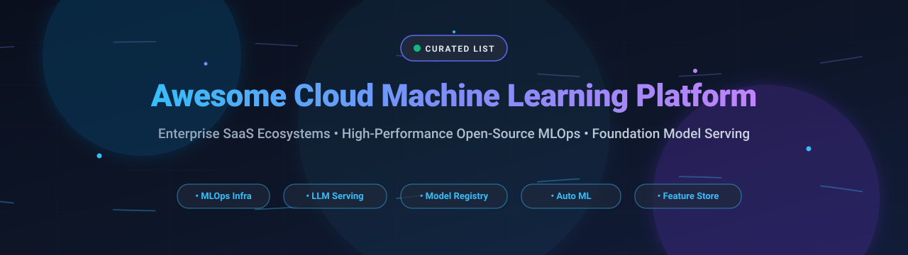

<div align="center">

<a href="https://github.com/ishandutta2007/Awesome-Awesome-Awesome"></a><a href="https://discord.gg/jc4xtF58Ve"></a>
<a href="https://github.com/ishandutta2007/Awesome-Cloud-Machine-Learning-Platform/stargazers"></a>
<a href="https://github.com/ishandutta2007/Awesome-Cloud-Machine-Learning-Platform/network/members"></a>
<a href="https://github.com/ishandutta2007/Awesome-Cloud-Machine-Learning-Platform/issues"></a>
<a href="https://github.com/ishandutta2007/Awesome-Cloud-Machine-Learning-Platform/blob/main/LICENSE"></a>
<a href="https://github.com/ishandutta2007"></a>

<br/><br/>

<a href="#readme">
  
</a>

# ☁️ Awesome Cloud Machine Learning Platform 🚀

**A Curated Directory of Enterprise SaaS Solutions & High-Performance Open-Source MLOps Infrastructure**

*Covering MLOps, LLM Serving, Distributed Training, AutoML, Experiment Tracking, Model Registry, Feature Stores & Self-Hosted Infrastructure*

[](https://github.com/ishandutta2007/Awesome-Cloud-Machine-Learning-Platform/pulls)
[](https://github.com/ishandutta2007/Awesome-Cloud-Machine-Learning-Platform/graphs/commit-activity)
[](https://github.com/ishandutta2007/Awesome-Awesome-Awesome)

---

</div>

## 📌 Introduction & Scope

Welcome to the definitive, production-tested index of **Cloud Machine Learning Platforms** 🌐. Whether your organization relies on fully-managed hyperscaler cloud platforms (AWS SageMaker, Google Cloud Vertex AI, Azure Machine Learning), specialized enterprise SaaS data platforms (Databricks Mosaic AI, Snowflake ML, DataRobot), or custom-tailored self-hosted open-source MLOps architectures (vLLM, Ray, MLflow, Airflow, Kubeflow, PyCaret), this repository provides an authoritative technical breakdown with granular pricing, verifiable limits, free tiers, and GitHub popularity metrics.

---

## 📑 Table of Contents

- [📊 Sector Overview & Market Dynamics](#-sector-overview--market-dynamics)
- [🏢 SaaS / Hosted ML Platforms](#-saas--hosted-ml-platforms)
- [🔓 Open-Source GitHub Projects](#-open-source-github-projects)
- [🛠️ Architectural Guidance: Composing Your ML Stack](#️-architectural-guidance-composing-your-ml-stack)
- [🤝 How to Contribute](#-how-to-contribute)
- [📈 Star History](#-star-history)
- [💖 Support & Sponsorship](#-support--sponsorship)
- [📜 Disclaimer & Compliance](#-disclaimer--compliance)

---

## 📊 Sector Overview & Market Dynamics

The global **Cloud Machine Learning Platform market** is projected to expand between **$114B and $135B by 2026** (scaling from ~$89B in 2025 at an impressive compound annual growth rate of ~30%), catalyzed by pervasive enterprise adoption of foundation models, multi-agent AI workflows, and cloud-scale GPU clusters.

The market exhibits a distinct **barbell concentration dynamic**:
1. **Hyperscaler Consolidation**: Foundational elastic compute infrastructure, GPU/TPU orchestration, and managed core platforms remain tightly consolidated among the Big 3 hyperscalers (**AWS SageMaker**, **Microsoft Azure Machine Learning**, and **Google Cloud Vertex AI**).
2. **Specialized & Open-Source Fragmentation**: The higher-level application, lakehouse data governance, visual AutoML, experiment management, and model observability layers remain **moderately fragmented** among independent innovators (Databricks, Snowflake, Dataiku, W&B) and rapidly emerging, modular open-source stacks.

---

## 🏢 SaaS / Hosted ML Platforms

*The following table analyzes the premier managed Cloud ML platforms, ranked in descending order by parent company scale (valuation / market capitalization).*

| 🏷️ Platform | 💰 Company Scale | 📝 Description & Core Capabilities | 💳 Pricing (Starting Tier) | 🎁 Free Tier / Trial Limits | 🎯 Best For |
| :--- | :--- | :--- | :--- | :--- | :--- |
| **[Microsoft Azure Machine Learning](https://azure.microsoft.com/en-us/products/machine-learning)** | **~$3.1T** Market Cap (Microsoft) | Enterprise ML platform featuring comprehensive governance via Azure Policy, automated compliance (ISO, SOC, HIPAA, GDPR), ML Studio visual pipelines, and AKS cluster deployment. | Pay-as-you-go compute infrastructure only ($0 platform fee; compute starts at ~$0.04/hr for `Standard_B2s` / ~$0.29/hr for `Standard_DS3_v2`). | **$200 credit for 30 days** on sign-up; plus 12 months access to select free services (capped at 4 vCPUs quota on trial accounts). | Microsoft-centric enterprises needing rigid governance and automated Azure DevOps integration. |
| **[Google Cloud Vertex AI](https://cloud.google.com/vertex-ai)** | **~$2.1T** Market Cap (Alphabet) | Unified ML and GenAI platform optimized for Gemini foundation models; Vertex Pipelines (Kubeflow-based), Model Garden, and native AutoML. | Pay-as-you-go by resource consumption (e.g., custom training from ~$0.056/node-hr; Gemini 1.5 Flash text output from ~$0.30 per 1M tokens; online prediction from ~$0.05/node-hr). | **$300 credit for 90 days** across Google Cloud (no always-free compute tier for Vertex AI endpoints; charges incur once credits expire). | GCP-native organizations building GenAI products on Gemini and foundation model workflows. |
| **[AWS SageMaker](https://aws.amazon.com/sagemaker/)** | **~$2.0T** Market Cap (Amazon) | Comprehensive end-to-end managed ML platform covering data labeling, pipelines, training, Model Registry, Clarify governance, and Bedrock/JumpStart integration. | Pay-as-you-go based on compute/storage (e.g., `ml.t3.medium` notebooks from ~$0.05/hr; serverless inference from $0.00002/sec). | **2-month (60-day) Free Tier**: 250 hrs/mo `ml.t3.medium` notebooks, 50 hrs/mo `m4/m5.xlarge` training, 125 hrs/mo `m4/m5.xlarge` inference, and 150K serverless inference seconds. | AWS-native organizations requiring complete lifecycle governance and large-scale model deployments. |
| **[Databricks Mosaic AI](https://www.databricks.com/product/machine-learning)** | **$190B** Valuation (Series L/M 2026; ~$7B ARR) | Lakehouse ML platform unifying data pipelines and ML; MLflow 3.0, Unity Catalog governance, high-throughput model serving, and Mosaic AI custom fine-tuning. | Pay-as-you-go consumption based on DBUs (Jobs compute from ~$0.15/DBU; All-Purpose / Model Serving compute from ~$0.55/DBU). | **Free Edition (perpetual)**: Serverless compute, 1 `2X-Small` SQL warehouse, up to 5 concurrent tasks, 3 apps (subject to daily fair usage caps); or **14-day evaluation trial** with **$400 in DBUs**. | Code-first data science and ML engineering teams committed to open lakehouse formats and MLflow. |
| **[Snowflake ML](https://www.snowflake.com/en/product/features/machine-learning/)** | **~$50B** Market Cap (~$3.6B ARR) | In-database ML capabilities on the AI Data Cloud; Snowpark for Python, Native Model Registry, Snowpark Container Services (SPCS) for GPUs, and Cortex AI SQL functions. | Pay-as-you-go consumption based on Snowflake credits (Standard Edition starts at **$2.00 per credit**; Enterprise Edition at **$3.00 per credit**). | **30-day Free Trial with $400 in usage credits** (no credit card required; access expires when credits are depleted or 30 days elapse). | Snowflake-centric teams seeking to train and query ML/GenAI models directly inside the warehouse boundary. |
| **[Dataiku](https://www.dataiku.com/)** | **$3.7B** Valuation (~$350M ARR) | Everyday AI platform designed for collaborative data science, visual drag-and-drop ML recipes, AutoML, code notebooks, and LLM Mesh routing. | Annual enterprise subscription; entry-tier business plans start at approximately **$4,000/month** (~$48,000/yr). | **Free Edition (perpetual)**: Self-hosted on local hardware for up to **3 users**; or a **14-day fully-managed cloud trial** with 4 CPUs / 32 GiB RAM provisioned. | Cross-functional teams pairing citizen data scientists with technical coders in a visual collaborative workspace. |
| **[Weights & Biases](https://wandb.ai/)** | **$1.7B** Valuation / Acquired by CoreWeave | Specialized MLOps platform for experiment tracking, hyperparameter tuning (Sweeps), model registry, and LLM observability (Weave). | Team/Pro tier starts at **$50 to $60/user/month** (billed monthly); custom pricing for Enterprise. | **Free Forever Personal Tier**: 1 user, up to 5 model seats, **5 GB cloud storage/month**, 1 GB Weave tracing/month, capped at 50 requests/min. | Researchers and ML engineering teams wanting dedicated experiment tracking and deep training visualization. |
| **[H2O.ai](https://h2o.ai/)** | **$1.7B** Valuation (~$75M ARR) | Enterprise automated ML platform featuring H2O Driverless AI, automated feature engineering, model explainability, and open-source H2O-3 core. | Annual enterprise license starting at approximately **$100,000 to $130,000/year** (or custom private offers on AWS/Azure Marketplace). | **21-day Free Trial License** for self-hosted or cloud evaluation of Driverless AI; or **2-hour interactive test drive** on H2O Aquarium cloud. | Enterprise predictive modeling teams prioritizing automated tabular modeling, compliance, and explainable AI. |
| **[DataRobot](https://www.datarobot.com/)** | **$500M - $1B** Implied Valuation (~$285M ARR) | Enterprise AI platform specializing in automated machine learning (AutoML), GenAI playgrounds, and model governance/deployment automation. | Enterprise annual contracts starting at approximately **$24,000 to $50,000/year** for entry-level team scopes (median contracts ~$212,000/year). | **30-day Free Trial**: Shared modeling workers, batch predictions, up to 15 vector databases, and 1,000 LLM calls (no dedicated GPUs; no credit card required). | Organizations wanting automated end-to-end ML model creation and compliance guardrails without extensive custom code. |
| **[Domino Data Lab](https://www.dominodatalab.com/)** | **$500M - $1B** Valuation (~$35M - $45M ARR) | Regulated enterprise MLOps platform offering hybrid/multi-cloud orchestration, reproducible project environments, and governed model deployment. | Custom enterprise quotes; entry commitments typically start in the **$30,000 to $50,000/year** range depending on user seats and VPC tier. | **14-day guided enterprise PoC / evaluation trial** upon sales request (or 2-week lab access via NVIDIA LaunchPad partnership with pre-allocated compute). | Highly regulated enterprise data science teams (pharma, banking, insurance) requiring reproducible and governed workflows. |

---

## 🔓 Open-Source GitHub Projects

*The following open-source frameworks and self-hosted ML infrastructure projects are sorted in **descending order by GitHub stargazers count**. Each project includes a live Stars_Badge linking directly to its GitHub stargazers page.*

### 1. **[vLLM](https://github.com/vllm-project/vllm)** <a href="https://github.com/vllm-project/vllm/stargazers"></a>
- **Description**: High-throughput, memory-efficient LLM inference and model serving engine powered by PagedAttention. Features continuous batching, chunked prefill, tensor parallelism, and OpenAI-compatible API serving.
- **License**: Apache 2.0
- **Tech Stack**: Python, C++, CUDA
- **Best For**: High-throughput production LLM model serving and self-hosted GenAI inference clusters.

### 2. **[Apache Airflow](https://github.com/apache/airflow)** <a href="https://github.com/apache/airflow/stargazers"></a>
- **Description**: The de facto industry standard for orchestrating programmatic workflows, ML training pipelines, ETL processes, and batch inference workflows using Python DAGs.
- **License**: Apache 2.0
- **Tech Stack**: Python
- **Best For**: Production enterprise teams seeking mature, battle-tested orchestration across complex multi-system ML and data pipelines.

### 3. **[Ray](https://github.com/ray-project/ray)** <a href="https://github.com/ray-project/ray/stargazers"></a>
- **Description**: Unified framework for distributed compute and scaling AI workloads. Includes Ray Train (distributed PyTorch/DeepSpeed training), Ray Data (streaming data preprocessing), Ray Serve (multi-model serving), and Ray Tune (distributed hyperparameter optimization).
- **License**: Apache 2.0
- **Tech Stack**: Python, C++
- **Best For**: Distributed machine learning training, large-scale reinforcement learning, and elastic compute clustering.

### 4. **[Langfuse](https://github.com/langfuse/langfuse)** <a href="https://github.com/langfuse/langfuse/stargazers"></a>
- **Description**: Leading open-source LLM engineering platform providing full-lifecycle observability, prompt versioning, automated LLM evaluations, tracing, and token cost tracking.
- **License**: MIT
- **Tech Stack**: TypeScript, Python, Next.js, PostgreSQL, ClickHouse
- **Best For**: Teams developing GenAI applications needing granular LLMOps observability, RAG tracing, and prompt governance.

### 5. **[MLflow](https://github.com/mlflow/mlflow)** <a href="https://github.com/mlflow/mlflow/stargazers"></a>
- **Description**: The standard open-source platform for managing the end-to-end ML lifecycle. Features experiment tracking (metrics, parameters, artifacts), Model Registry with immutable aliases (`@champion`, `@candidate`), MLflow Projects, and MLflow 3.0 GenAI agent evaluation.
- **License**: Apache 2.0
- **Tech Stack**: Python, R, Java
- **Best For**: Core experiment tracking, central model artifact registry, and reproducible ML workflows.

### 6. **[Prefect](https://github.com/PrefectHQ/prefect)** <a href="https://github.com/PrefectHQ/prefect/stargazers"></a>
- **Description**: Modern, code-as-workflows orchestration framework designed with native async Python, dynamic DAG generation, automatic retries, and comprehensive task-level scheduling.
- **License**: Apache 2.0
- **Tech Stack**: Python
- **Best For**: Developers seeking flexible, Pythonic pipeline orchestration without the heavyweight operational complexity of legacy systems.

### 7. **[DVC (Data Version Control)](https://github.com/iterative/dvc)** <a href="https://github.com/iterative/dvc/stargazers"></a>
- **Description**: Open-source version control system for machine learning projects. Extends Git to track multi-gigabyte datasets, models, and pipeline intermediate artifacts with S3/GCS/Azure blob remote storage.
- **License**: Apache 2.0
- **Tech Stack**: Python
- **Best For**: Machine learning data reproducibility, Git-integrated dataset versioning, and deterministic model pipelines.

### 8. **[Kubeflow](https://github.com/kubeflow/kubeflow)** <a href="https://github.com/kubeflow/kubeflow/stargazers"></a>
- **Description**: Cloud-native ML toolkit and pipeline orchestrator built directly on Kubernetes. Integrates Kubeflow Pipelines (KFP), Katib (hyperparameter tuning), Notebook controller, and distributed training operators.
- **License**: Apache 2.0
- **Tech Stack**: Go, Python, Kubernetes
- **Best For**: Dedicated platform engineering teams running multi-tenant ML infrastructure on enterprise Kubernetes clusters.

### 9. **[Metaflow](https://github.com/Netflix/metaflow)** <a href="https://github.com/Netflix/metaflow/stargazers"></a>
- **Description**: Human-friendly ML framework developed by Netflix for designing, prototyping, and executing production data science workflows seamlessly between local laptops and cloud compute (AWS/GCP/Azure).
- **License**: Apache 2.0
- **Tech Stack**: Python
- **Best For**: Data scientists prioritizing pure Python productivity with effortless cloud compute scaling and data snapshotting.

### 10. **[PyCaret](https://github.com/pycaret/pycaret)** <a href="https://github.com/pycaret/pycaret/stargazers"></a>
- **Description**: Open-source, low-code machine learning library and tabular AutoML engine. Automates feature engineering, imputation, model benchmarking, hyperparameter tuning, ensembling, and pipeline export.
- **License**: Apache 2.0
- **Tech Stack**: Python, scikit-learn
- **Best For**: Rapid tabular data experimentation, baseline model benchmarking, and self-hosted low-code AutoML pipelines.

### 11. **[BentoML](https://github.com/bentoml/BentoML)** <a href="https://github.com/bentoml/BentoML/stargazers"></a>
- **Description**: High-performance model serving framework that packages ML models and LLMs into optimized containerized services with adaptive batching, multi-worker concurrency, and OpenAPI schemas.
- **License**: Apache 2.0
- **Tech Stack**: Python
- **Best For**: Deploying, optimizing, and containerizing ML inference APIs with minimal latency and high concurrency.

### 12. **[Evidently AI](https://github.com/evidentlyai/evidently)** <a href="https://github.com/evidentlyai/evidently/stargazers"></a>
- **Description**: Production ML and LLM observability library offering 100+ tests for data drift, concept drift, regression/classification degradation, and automated text evaluation.
- **License**: Apache 2.0
- **Tech Stack**: Python
- **Best For**: Lightweight, test-driven model validation in CI/CD and self-hosted production drift monitoring dashboards.

### 13. **[Flyte](https://github.com/flyteorg/flyte)** <a href="https://github.com/flyteorg/flyte/stargazers"></a>
- **Description**: Production-grade, Kubernetes-native workflow automation engine built originally by Lyft. Features strongly typed interfaces, task caching, multi-tenancy, and distributed execution graphs.
- **License**: Apache 2.0
- **Tech Stack**: Go, Python
- **Best For**: Large-scale data engineering teams demanding deterministic, type-safe execution graphs and cached distributed tasks.

### 14. **[Feast](https://github.com/feast-dev/feast)** <a href="https://github.com/feast-dev/feast/stargazers"></a>
- **Description**: De facto open-source feature store for machine learning. Manages offline historical features for model training and online low-latency stores (Redis, DynamoDB) for real-time inference with point-in-time correctness (`AS OF` joins).
- **License**: Apache 2.0
- **Tech Stack**: Python, Go
- **Best For**: Teams needing unified real-time and batch feature ingestion without training-serving skew.

### 15. **[ClearML](https://github.com/allegroai/clearml)** <a href="https://github.com/allegroai/clearml/stargazers"></a>
- **Description**: Open-source, batteries-included MLOps suite combining experiment management, autonomous orchestration agent workers, dataset versioning, and model serving.
- **License**: Apache 2.0
- **Tech Stack**: Python, Vue
- **Best For**: Teams desiring an integrated, end-to-end self-hosted MLOps platform without stitching together multiple disjointed tools.

### 16. **[KServe](https://github.com/kserve/kserve)** <a href="https://github.com/kserve/kserve/stargazers"></a>
- **Description**: Standardized serverless model inference platform on Kubernetes. Provides autoscaling (including scale-to-zero), canary rollouts, inference graphs, and native protocol support across major ML runtimes.
- **License**: Apache 2.0
- **Tech Stack**: Go, Python, Kubernetes
- **Best For**: Cloud-native infrastructure teams seeking serverless, multi-framework model serving with automated scaling on Kubernetes.

### 17. **[ZenML](https://github.com/zenml-io/zenml)** <a href="https://github.com/zenml-io/zenml/stargazers"></a>
- **Description**: Extensible, cloud-agnostic MLOps pipeline framework that bridges local data science experimentation with cloud infrastructure (Kubeflow, Airflow, GCP, AWS, Azure) through standardized abstractions.
- **License**: Apache 2.0
- **Tech Stack**: Python
- **Best For**: Teams building portable, cloud-agnostic ML pipelines that execute effortlessly across diverse backends.

### 18. **[ZebraOps](https://github.com/flexiana/zebraops)** <a href="https://github.com/flexiana/zebraops/stargazers"></a>
- **Description**: Local-first MLOps platform tailored for beginners and agile teams. Features an integrated CLI with pre-configured Docker Compose stacks (MLflow, Prefect, FastAPI, Evidently, MinIO, Grafana).
- **License**: Apache 2.0
- **Tech Stack**: Python, Docker
- **Best For**: Developers and small teams wanting a turn-key, local-first MLOps environment that bootstraps in seconds.

---

## 🛠️ Architectural Guidance: Composing Your ML Stack

When designing an enterprise-grade or production ML stack, engineering teams face three primary architectural patterns:

```
┌────────────────────────────────────────────────────────────────────────┐
│                   Managed Hyperscaler End-to-End                      │
│      AWS SageMaker  |  Google Cloud Vertex AI  |  Azure Machine Learning│
└───────────────────────────────────┬────────────────────────────────────┘
                                    │
                                    ▼
┌────────────────────────────────────────────────────────────────────────┐
│                   Unified Lakehouse / Data Platforms                   │
│              Databricks Mosaic AI   |   Snowflake ML                   │
└───────────────────────────────────┬────────────────────────────────────┘
                                    │
                                    ▼
┌────────────────────────────────────────────────────────────────────────┐
│             Composed Best-of-Breed Open-Source Architecture            │
│  Orchestration:   Apache Airflow / Prefect / Flyte / Metaflow           │
│  Tracking & Reg:  MLflow / ClearML                                      │
│  Feature Store:   Feast                                                │
│  Model Serving:   vLLM / BentoML / KServe / Ray Serve                   │
│  Observability:   Langfuse / Evidently AI                               │
└────────────────────────────────────────────────────────────────────────┘
```

1. **Turnkey Convenience vs. Vendor Lock-In**:
   - Hyperscaler suites (SageMaker, Vertex, Azure ML) provide all-in-one compliance and seamless IAM/storage integration, but create operational stickiness and higher egress/endpoint costs.
2. **Modularity & Cost Efficiency**:
   - Composing **MLflow** (tracking/registry) with **vLLM / BentoML** (serving), **Airflow / Prefect** (orchestration), and **Langfuse / Evidently** (observability) yields maximum cost control, open data formats, and multi-cloud portability.

---

## 🤝 How to Contribute

Contributions are warmly welcome! To maintain high editorial and technical standards:

1. 🍴 **Fork the repository**.
2. 🌿 **Create a new branch**: `git checkout -b feature/add-new-tool`.
3. 📝 **Add your entry** under the appropriate section:
   - For **SaaS**: Include platform name, company scale, description, starting tier price, free tier limits, and best-for persona.
   - For **Open-Source**: Include repository name, verified GitHub link, Stars_Badge, description, license, tech stack, and use-case focus.
4. 🚀 **Commit your changes**: `git commit -m "Add [Tool Name]"`.
5. 📤 **Submit a Pull Request** with a concise technical explanation.

---

## 📈 Star History

[](https://star-history.dera.page/#ishandutta2007/Awesome-Cloud-Machine-Learning-Platform&type=date&legend=top-left)

---

## 💖 Support & Sponsorship

If you find this curated directory helpful for your team, organization, or research:

- ⭐ **Star this repository** to support our open-source indexing work!
- 🍴 **Fork and share** with fellow ML engineers, data scientists, and MLOps architects.
- ☕ **Support the author**: If you would like to support ongoing updates, maintenance, and research, consider buying a coffee via our [GitHub Sponsor Dashboard](https://github.com/sponsors/ishandutta2007).

---

## 📜 Disclaimer & Compliance

- This repository is a community-curated technical index and does not represent direct commercial endorsements.
- Platform pricing and product limits are actively monitored and reflected based on official vendor documentation as of 2026; however, enterprise contract pricing and cloud consumption rates are subject to change. Always verify with respective vendors for final architectural sizing.
- Organizations processing regulated data (HIPAA, GDPR, CCPA) must ensure that any deployed cloud or self-hosted ML infrastructure complies with organizational data residency and governance boundaries.

---

<div align="center">

**Made with ❤️ for ML engineers, data scientists, and cloud architects worldwide.**

</div>
